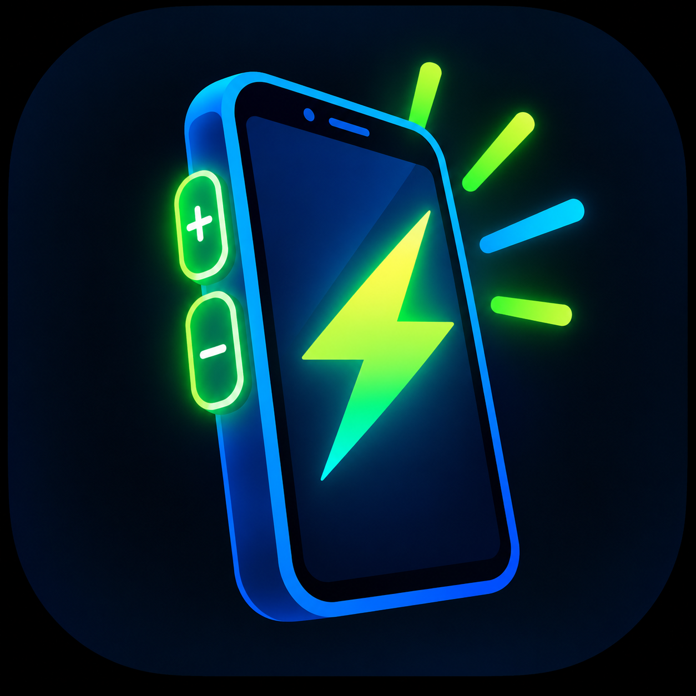
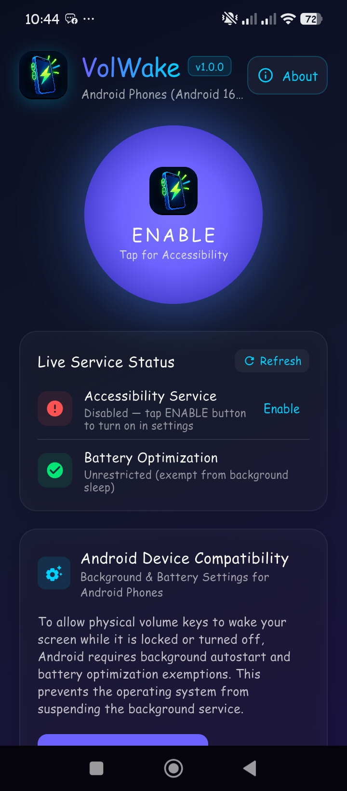
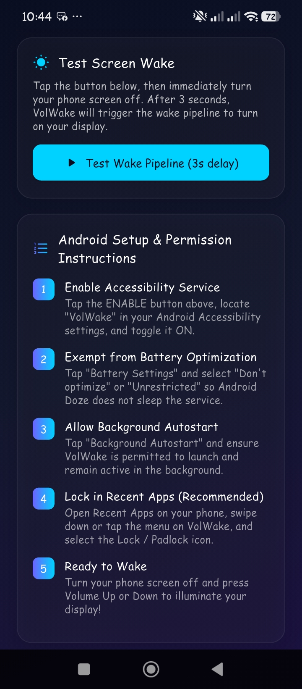

<p align="center">
  
</p>

<h1 align="center">VolWake 🔊📱</h1>

<p align="center">
  <a href="https://opensource.org/licenses/MIT"></a>
  <a href="https://flutter.dev"></a>
  <a href="https://github.com/ChamiduDev/VolWake/releases"></a>
</p>

<p align="center">
  <strong>Volume Key Display Wake Utility for Android</strong>
</p>

---

**VolWake** is a lightweight, efficient Android utility application designed to wake up your smartphone display using the physical Volume Up or Down buttons. 

It is specifically built for devices with broken, unresponsive, or damaged power buttons, restoring full screen-wake functionality without draining your battery.

---

## ✨ Features

- 🔊 **Hardware Volume Key Wake:** Wake up the display using physical volume buttons when the screen is off.
- ⚡ **Zero Battery Overhead:** Uses a silent audio-track loop and `MediaSession` handling to route key events reliably with minimal power usage.
- 🛡️ **Android Device Compatibility:** Includes direct native shortcuts to Autostart and Battery Saver settings across supported Android devices.
- 🔓 **100% Free & Open Source:** Licensed under the MIT License with absolutely no data collection or tracking.

---

## 📱 Screenshots

| Main Screen | About & Settings |
| :---: | :---: |
|  |  |

---

## 🚀 Installation

1. Go to the [Releases](https://github.com/ChamiduDev/VolWake/releases) section.
2. Download the latest `app-release.apk`.
3. Install the APK on your Android device.
4. Open **VolWake**, grant the necessary **Accessibility** and **Background Execution** permissions.
5. Turn off the screen and test waking up using the Volume keys!

> **Note on Google Play Protect:**  
> When sideloading the APK, Google Play Protect may show an *"Unrecognized app"* prompt because the APK is signed outside the Play Store. You **do not** need to turn off Play Protect. Simply tap **More details** and select **Install anyway** to proceed while keeping your device fully protected.

---

## ⚙️ Permissions Required

To operate reliably while your phone is locked or turned off, VolWake requires:

| Permission | Purpose |
| :--- | :--- |
| **Accessibility Service** | Detects hardware Volume Up and Volume Down key presses when the screen is turned off. |
| **Foreground Service** | Keeps the background service persistent so the Android system does not terminate it. |
| **WakeLock** | Coordinates the screen wake pipeline to illuminate the display and lock screen. |
| **Battery Optimization Exemption** | Prevents Android Doze mode from sleeping the service during long standby periods. |

---

## 🛠️ Built With

- **Framework:** [Flutter](https://flutter.dev)
- **Language:** Dart & Kotlin
- **Target OS:** Android 8.0+ (API 26+)

---

## 🛠️ Building from Source

If you want to build the app locally from source code:

### Prerequisites
- [Flutter SDK](https://flutter.dev/docs/get-started/install) (v3.0.0 or higher)
- [Android Studio](https://developer.android.com/studio) / Android SDK (API Level 26+)
- Git

### Build Instructions

1. **Clone the repository:**
   ```bash
   git clone https://github.com/ChamiduDev/VolWake.git
   cd VolWake
   ```

2. **Install Flutter dependencies:**
   ```bash
   flutter pub get
   ```

3. **Verify project setup:**
   ```bash
   flutter analyze
   ```

4. **Build APK:**
   - **Debug APK:**
     ```bash
     flutter build apk --debug
     ```
   - **Release APK:**
     ```bash
     flutter build apk --release
     ```

   The generated APK will be located at `build/app/outputs/flutter-apk/`.

---

## 🤝 Contributing

Contributions, bug reports, and feature suggestions are welcome!
1. Fork the Project.
2. Create your Feature Branch (`git checkout -b feature/NewFeature`).
3. Commit your Changes (`git commit -m 'Add NewFeature'`).
4. Push to the Branch (`git push origin feature/NewFeature`).
5. Open a Pull Request.

---

## 📄 License

This project is licensed under the MIT License - see the [LICENSE](LICENSE) file for details.

---

## 👨‍💻 Developer

**Chamindu Kavishka**
- GitHub: [@ChamiduDev](https://github.com/ChamiduDev)
- Repository: [VolWake](https://github.com/ChamiduDev/VolWake)
- LinkedIn: [Chamindu Kavishka](https://www.linkedin.com/in/chamindu-kavishka-0ba512326)
